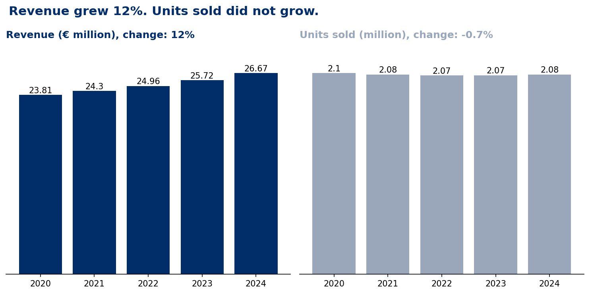
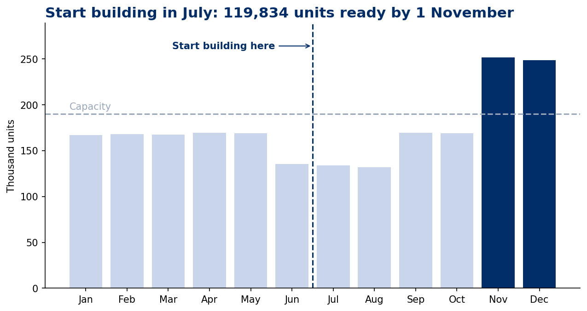
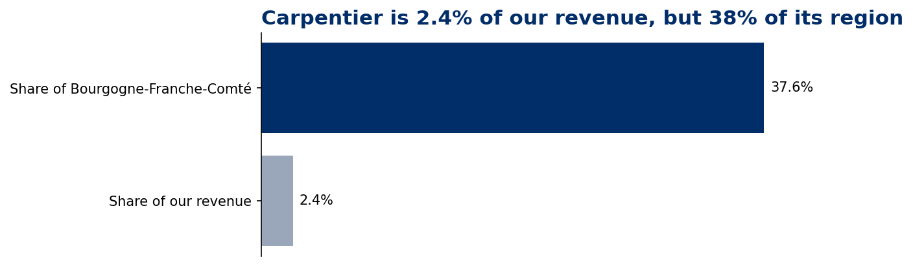

# Revenue grew 12%, but units sold stayed flat. Four business decisions from 60 messy Excel tabs.

Python (pandas, NumPy, matplotlib, GeoPandas) · 396,978 order lines from 60 Excel tabs, 2020–2024 · 275 wholesalers · Fictional company, simulated data · [Technical documentation](TECHNICAL_README.md)

## What's in this repository

| File or folder | What it is |
| --- | --- |
| `README.md` | This page: the business case, findings and recommendations |
| [TECHNICAL_README.md](TECHNICAL_README.md) | Data sources, data quality issues, business inputs, assumptions and calculations |
| [notebooks/widgeterie_decisions.ipynb](notebooks/widgeterie_decisions.ipynb) | The full Python analysis, from data preparation to the four business decisions |
| [images/](images/) | Charts supporting the four decisions |
| [data/](data/) | Information about the input data and its availability |

> **Executive summary**
>
> La Widgeterie makes 20 industrial parts and sells them to 275 wholesalers across France. Its management team needed to make four decisions: whether to renew a sales bonus plan, when to build stock for seasonal demand, whether to discontinue SKU-9325, and whether to protect the company against the risk of losing an important regional wholesaler.
>
> The answers were buried in five years of sales data spread across 60 messy Excel tabs. I took the role of a data analyst: I consolidated the files, cleaned missing values and inconsistent product codes, enriched transactions with wholesaler locations, and used Python to evaluate the four decisions.
>
> **My recommendation to the COO:** do not renew the €250,000-a-year sales bonus plan or increase it to €400,000. Revenue grew 12.0% from 2020 to 2024, but units sold fell 0.7%. Average annual volume was 2,088,694 units before the plan and 2,074,701 after it started in 2022. The increase in revenue came alongside a 12.8% rise in average price per unit, not an increase in units sold.
>
> For the other decisions, I recommend signing the €15,000 backup agreement with Payet, starting production in July, and keeping SKU-9325. Carpentier represents only 2.4% of company revenue but 37.6% of revenue in its region. The backup agreement lowers expected cost from €33,227 to €24,494. Production planning requires 119,834 units in stock by 1 November. Discontinuing SKU-9325 would save €150,000 but put €262,039 of contribution margin at risk.

## The four decisions

I used the cleaned sales data to answer four practical questions: Did the bonus plan increase the number of units sold? When should production start? What would the company lose by discontinuing SKU-9325? How exposed is the business if Carpentier fails?

### 1. Don't renew the sales bonus plan: units sold did not grow

The sales bonus plan should not be renewed, and its budget should not increase to €400,000.

Since the plan started in 2022, La Widgeterie sold an average of 2,074,701 units per year, compared with 2,088,694 units in 2020 and 2021. Over the three years, the plan cost €750,000.

Revenue increased by 12.0% between 2020 and 2024, but units sold decreased by 0.7%. Average price per unit increased by 12.8%, from €11.36 to €12.82. Revenue growth alone does not demonstrate that the bonus plan increased sales volume.

**My recommendation:** do not renew the plan. If the company introduces another sales incentive, it should track units sold as well as revenue.

**What I would investigate next:** what would sales volume have been without the bonus plan? The data cannot establish what would have happened if the plan had not existed or if market conditions had been different.

### 2. Start building stock in July: 119,834 units ready by 1 November

The plant should start building stock in July and have 119,834 units available on 1 November.

The monthly production capacity is 190,000 units. November and December are the only months above that capacity, requiring an additional 61,480 and 58,354 units respectively, on average.

Working backwards from December, the company needs 19,897 units already in stock on 1 August. Starting production in July gives the plant time to build the required stock before the seasonal peak.

**My recommendation:** start building stock in July and monitor inventory against the monthly production plan.

**What I would investigate next:** compare the average monthly demand used in this plan with the highest-demand year, current inventory and supplier lead times.

### 3. Keep SKU-9325: dropping it saves €150K but puts €262K of margin at risk

The company should keep SKU-9325. Discontinuing it would save €150,000 a year but put €262,039 of contribution margin at risk.

The estimated margin loss includes €112,314 from SKU-9325 itself and €149,725 from other parts that four wholesalers could move to a competitor. Those other parts represent €499,084 in sales.

SKU-9325 alone represents only 1.4% of revenue, which could make it look like an easy product to discontinue. However, four wholesalers indicated that they would move every order containing this SKU to a competitor.

**My recommendation:** keep SKU-9325. The estimated margin at risk is €112,039 higher than the proposed savings.

**What I would investigate next:** confirm whether the four wholesalers would actually move all those orders and explore whether the €150,000 handling cost could be reduced without discontinuing the product.

### 4. Sign the backup agreement with Payet: Carpentier represents 37.6% of regional revenue

The company should sign the €15,000-a-year backup agreement with Payet, another wholesaler in Carpentier's city.

Carpentier represents 2.4% of total company revenue but 37.6% of revenue in Bourgogne-Franche-Comté. It also accounts for more than 40% of regional sales for 7 of the 20 parts, reaching 45.6% for SKU-2972.

With an assumed 25% chance that Carpentier fails within a year, the expected cost is €33,227 without the agreement and €24,494 with it, including the agreement's price. The agreement is worthwhile as long as the estimated probability of failure remains above 15.8%.

**My recommendation:** sign the backup agreement with Payet to reduce the company's exposure to a potential loss of Carpentier.

**What I would investigate next:** validate the 25% failure probability, review the agreement's conditions and monitor Carpentier's share of regional sales.

## Recommendations

| Priority | Action | Expected impact | Metric to track | Owner |
| --- | --- | --- | --- | --- |
| 1 | Do not renew the sales bonus plan or increase its budget to €400,000 | Saves €250,000 a year on a plan with no increase in units sold | Annual units sold, compared with the pre-plan average of 2,088,694 | COO and Head of Sales |
| 2 | Sign the €15,000 backup agreement with Payet | Reduces expected annual cost by €8,733, from €33,227 to €24,494 | Carpentier's payment delays and the estimated probability of failure; break-even point: 15.8% | CFO and Head of Sales |
| 3 | Start building stock in July | Prepare 119,834 units for 1 November and cover the seasonal production peak | Stock against plan on the first day of each month, late deliveries and overtime hours | Plant Manager |
| 4 | Keep SKU-9325 | Protects €262,039 of estimated annual margin, €112,039 more than the proposed savings | Orders and margin from the four wholesalers | CFO and Head of Sales |

## Assumptions, limitations and further investigation

### Assumptions

- The contribution margin is 30% of sales for every part, based on the company's input.
- The stock plan uses the average sales for each month across the five years.
- Decisions 3 and 4 use 2024, the last full year in the dataset.
- Missing sales are estimated as quantity multiplied by the average price of the same part in the same year.
- The four wholesalers who reported that they would move their orders are assumed to move every order containing SKU-9325.
- The estimated probability of Carpentier failing within a year is 25%.

### Limitations

- The dataset contains wholesaler orders, not final sales to end customers.
- The data does not include actual production costs, inventory levels or delivery dates.
- The bonus plan, plant capacity, contribution margin, probability of failure and wholesaler survey responses are business inputs, not values inferred from transaction data.
- Historical averages do not guarantee future demand.
- The analysis identifies patterns and estimates business exposure, but it does not prove that the bonus plan caused the observed sales changes.

### What I would investigate next

- What targets, products and customers did the bonus plan reward, and how did the market change during the same period?
- Why has unit volume not grown over the five years?
- Would the four wholesalers really move all their orders if SKU-9325 were discontinued?
- Can the handling cost of SKU-9325 be reduced without discontinuing the product?
- Which other wholesalers are small at company level but important in their regions?
- Is the 25% probability of Carpentier failing supported by current financial and operational information?

## About the data

The analysis uses 396,978 order lines from 60 monthly Excel tabs covering 2020–2024.

The original data contained 6,541 missing Sales values (1.65%) and 60 different spellings for 20 product codes. I standardized the product codes and estimated missing sales using each part's average price in the corresponding year.

I also joined the transaction data with the wholesaler reference file to add city, region and geographic coordinates. I checked that the join did not increase or reduce the number of transaction records.

The full preparation process, issue log, business inputs and calculation details are available in the [technical documentation](TECHNICAL_README.md). The complete code is available in the [Jupyter notebook](notebooks/widgeterie_decisions.ipynb).

## About me

I'm developing my skills in data analytics through practical projects at Savila Education. In this case, I worked with Python to transform messy data into structured information and business recommendations.

I enjoy the challenge of connecting technical analysis with real business questions, checking assumptions and explaining what the numbers can—and cannot—tell us.

**Contact:** [Your Name] · [LinkedIn URL] · [Portfolio URL]
